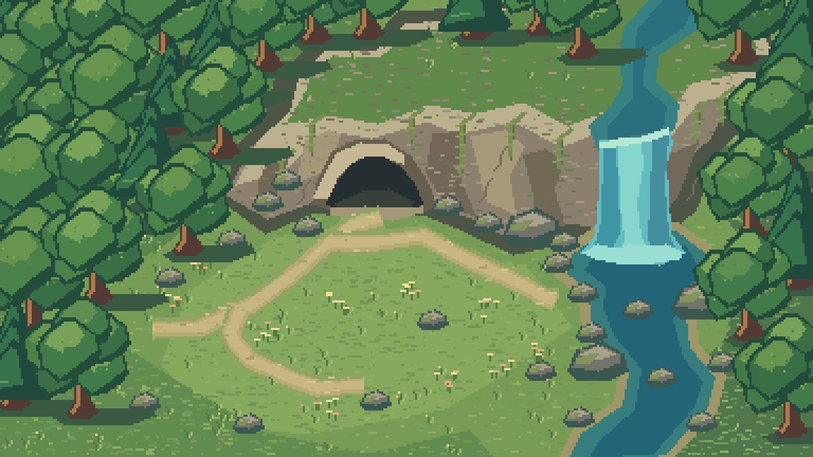
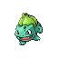
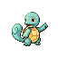

# 🌿 PokeLife

Um cantinho Pokémon para acompanhar sua rotina no Windows. Escolha seu companheiro e veja a Floresta de Viridian ganhar vida enquanto você usa o computador.



## Escolha seu companheiro

  

🌱 **Bulbasaur**, 🔥 **Charmander** ou 💧 **Squirtle**? A escolha é sua.

O sonho é criar um habitat em pixel art, com gramado, árvores, rio e caverna. O Pokémon poderá passear, descansar e evoluir. Cuidar dele será opcional, com alimentação e brincadeiras acelerando seu progresso.

## O que já existe

- Escolha do inicial e persistência local em SQLite.
- Protótipo de widget na barra de tarefas do Windows 11.
- Janela de habitat e primeiros experimentos com cenário, água e animação do Charmander.
- Testes automatizados para dados e partes da apresentação.

O projeto está em desenvolvimento. XP passivo, evolução, cuidados e rotinas completas fazem parte do planejamento e ainda precisam ser implementados e validados.

## Como executar

Use Windows 11 x64 e o SDK .NET 10. Na pasta do projeto, execute no PowerShell:

```powershell
dotnet build TaskbarHabitat.sln -c Release
dotnet test TaskbarHabitat.sln -c Release
& './src/TaskbarHabitat.Widget/bin/Release/net10.0-windows10.0.26100.0/win-x64/TaskbarHabitat.Widget.exe'
```

O save fica em `%LOCALAPPDATA%\TaskbarHabitat\save.db`. Dependências são restauradas pelo .NET durante a compilação.

## Explore o projeto

- [Visão e especificação do projeto](referencia/TaskbarHabitat-Relatorio.md)
- [Análise das referências visuais](referencia/Analise-PokeHabitat.md)
- [Plano do habitat](referencia/Plano-Habitat-Grande.md)
- [Plano de animação do Charmander](referencia/Plano-Animacao-Charmander.md)
- [Skills utilizadas e instalação](SKILLS_INSTALLED.md)

O código fica em `src/`, os testes em `tests/` e os planos em `referencia/`. Os arquivos de build e o save são locais.

## Próximas aventuras

1. Implementar e testar XP passivo, tempo offline e evolução.
2. Conectar caminhadas e descanso às animações do habitat.
3. Acrescentar alimentação, brincadeiras e indicadores de status.
4. Validar o widget em diferentes configurações do Windows e preparar uma versão distribuível.

PokeLife é um protótipo pessoal de aprendizado inspirado em Pokémon. Pokémon e seus personagens pertencem aos respectivos titulares. Os sprites usados no protótipo incluem referências à [PokéAPI](https://github.com/PokeAPI/sprites).
