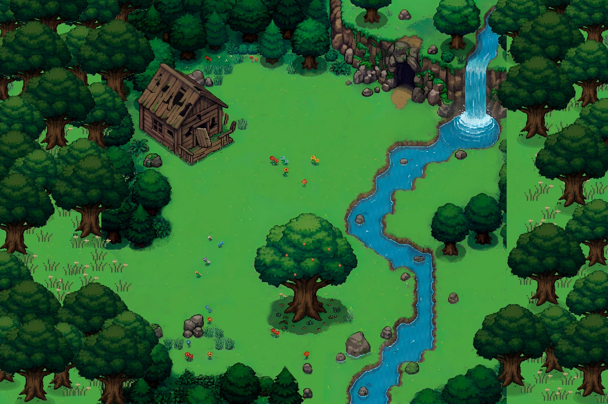

# 🌿 PokeLife

Um cantinho Pokémon no seu desktop. Escolha um companheiro, abra a Floresta de Viridian e veja a criatura explorar enquanto você toca o dia.

[](https://github.com/LucasRiboldi/Pokelife/actions/workflows/windows.yml)



## O que dá para fazer hoje

- Escolher **Bulbasaur**, **Charmander** ou **Squirtle**. A escolha fica salva no computador. O Charmander tem a animação mais completa do protótipo.
- Observar a criatura caminhar por destinos no mapa. A grade evita água e obstáculos. Pressione **F2** na janela do habitat para enxergar os bloqueios.
- Minimizar para pausar a animação, abrir o jogo novamente para restaurar a mesma janela ou fechar pelo **X**. Ao voltar, o inicial salvo reaparece.

O objetivo é ter uma criatura que ganha experiência e evolui com o tempo. Alimentar e brincar serão opcionais. **XP, evolução e progresso offline ainda estão no plano.**

## Rodar no Windows

Você precisa de **Windows 11 x64**, **Git** e do **SDK do .NET 10** compatível com [global.json](global.json). Execute no PowerShell.

```powershell
git clone https://github.com/LucasRiboldi/Pokelife.git
Set-Location Pokelife
dotnet build TaskbarHabitat.sln -c Release
& './src/TaskbarHabitat.Widget/bin/Release/net10.0-windows10.0.26100.0/win-x64/TaskbarHabitat.Widget.exe'
```

O save SQLite fica em `%LOCALAPPDATA%\TaskbarHabitat\save.db`. A compilação baixa as dependências. Depois de compilado, o jogo roda localmente.

## Desenvolver

| Pasta | Conteúdo |
| --- | --- |
| [`src/`](src/) | Modelo do save, dados e migrações SQLite, janela WinUI 3 e recursos do habitat. |
| [`tests/`](tests/) | Testes de dados, navegação e animação, mais um teste da janela com save temporário. |
| [`docs/`](docs/) | Documentação pública, créditos e prévia visual. |
| [`referencia/`](referencia/) | Plano do produto, mapa editável no Tiled e ferramentas de exportação. |

- [Contribuir, testar e editar o mapa](CONTRIBUTING.md)
- [Estado atual e ponto de retomada](STATE.md)
- [Plano mestre e cronograma](referencia/Plano-Mestre-PokeLife.md)
- [Créditos e origem dos recursos](docs/ASSETS.md)

O PokeLife é um protótipo independente de aprendizado inspirado em Pokémon. A licença do código próprio está pendente.
