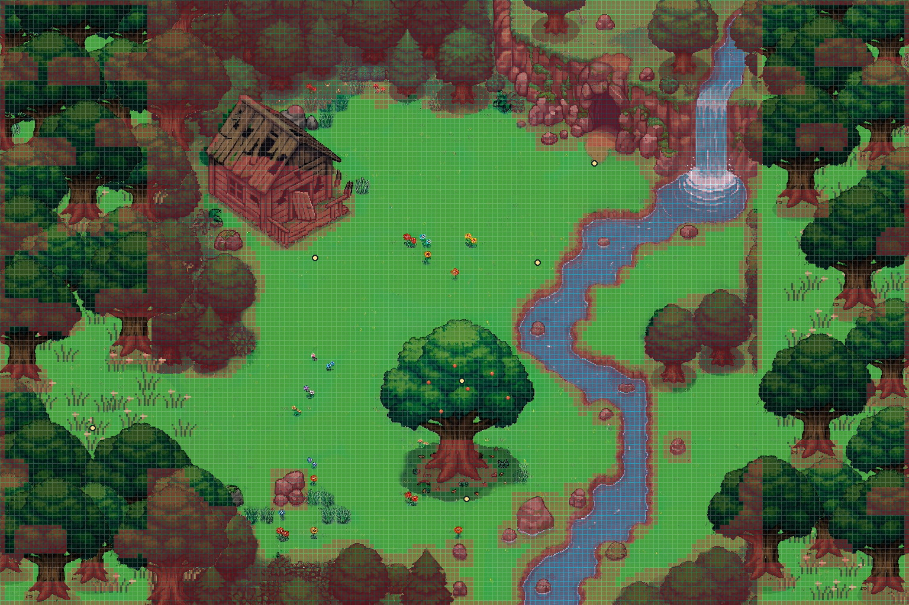

# Ampliação e caminhada em Viridian

## Mapa maior

O [mapa ampliado](Viridian-Ampliada.png) parte de [MAPA FINAL 1.png](MAPA%20FINAL%201.png) e passa de **2048 × 2048 para 3072 × 2048 pixels**. As novas faixas laterais aumentam a área em 50% e preservam a escala da arte. A clareira se conecta ao gramado pelo lado seco. A árvore frutífera continua no centro da composição, com a cabana e a caverna como pontos de referência. A câmera acompanha o Charmander.



A prévia marca os bloqueios e os destinos usados no jogo. Na janela do habitat, **F2** alterna a grade de bloqueios.

## Como a caminhada funciona

1. **Desenhar o terreno.** Marcar água até a margem, paredão, pedras, cabana e bases dos troncos como bloqueios. Marcar destinos no solo, como a sombra da árvore, o ponto de comer e a entrada da caverna.
2. **Gerar a grade.** Converter os bloqueios em células livres ou bloqueadas. Começar com células de **8 × 8 pixels na escala do jogo**, equivalentes a 16 × 16 na arte de referência. Isso dá 192 × 128 células no mapa ampliado. A marcação considera a largura dos pés do Charmander. Se uma passagem estreita ficar fechada na grade, ajustar o contorno ou a resolução.
3. **Encontrar e seguir a rota.** Quando o Charmander escolhe um destino, o algoritmo A* procura um caminho pelas células livres. A diagonal exige que as duas células vizinhas também estejam livres. A caminhada interpola as posições e qualquer atalho precisa respeitar a mesma margem de segurança. Se um destino estiver isolado, escolher outro alcançável. [Demonstração de A*](https://www.redblobgames.com/pathfinding/a-star/introduction.html)
4. **Desenhar a profundidade.** Separar a copa e o tronco do fundo. A base do tronco bloqueia a passagem. A árvore fica à frente quando os pés do Charmander estão atrás da base e fica ao fundo quando ele passa pela frente. A janela WinUI já usa a altura dos pés para ordenar o desenho.

## Ferramentas

- **A. Tiled, recomendado.** Abrir a imagem como fundo, contornar rio e troncos com polígonos e marcar pontos de interação. Os contornos seguem margens curvas e podem ser reutilizados em outros mapas. Versionar o mapa editável em JSON (`.tmj`) e gerar a grade a partir dele. Essa opção exige a etapa de conversão dos contornos. [Camadas do Tiled](https://doc.mapeditor.org/en/stable/manual/layers/) · [Modelos de objetos](https://doc.mapeditor.org/en/stable/manual/using-templates/) · [Formato JSON](https://doc.mapeditor.org/en/stable/reference/json-map-format/)
- **B. LDtk.** Abrir a imagem como fundo e pintar quadrados bloqueados diretamente na camada IntGrid. Exportar a grade em CSV e os pontos de interação em JSON. O processo começa mais rápido, mas cada margem irregular exige retocar os quadrados que a acompanham. [Camada IntGrid](https://ldtk.io/docs/general/intgrid-layers/) · [Exportação](https://ldtk.io/docs/game-dev/super-simple-export/)

## Editar e exportar

Abra [Viridian.tmj](Viridian.tmj) no Tiled. Edite os polígonos da camada `Bloqueios` para acompanhar as margens. Mova os pontos em `Destinos` para definir onde o Charmander pode parar. Na camada `Arvores`, a variante de cada ponto define a arte e a base de colisão.

Na raiz do projeto, com Python e Pillow disponíveis, rode estes comandos para reconstruir a arte e a grade. Se editar apenas bloqueios ou destinos, rode somente o último comando.

```powershell
python referencia/gerar-viridian.py
python referencia/gerar-viridian-ampliada.py
python referencia/exportar-navegacao.py
```

O exportador verifica se todos os destinos são alcançáveis e gera `navigation.json`, `grade.png` e a prévia sobre o mapa. A janela carrega os arquivos em `Assets/Habitats/ViridianAmpliada`. Os testes de navegação usam a mesma grade.

## Como crescer

O editor cuida da marcação. O jogo em C# carrega a grade, as posições dos objetos e os pontos de interação. Uma árvore reutilizável tem arte, ponto de apoio no chão e contorno da base. A posição de cada instância aplica o mesmo contorno ao novo local. Animações de vento podem usar a mesma base de colisão. Quando houver vários habitats, cada um pode ter sua própria grade e seus próprios destinos.
